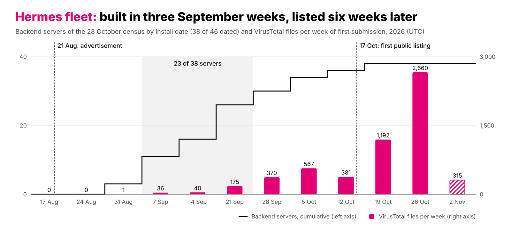
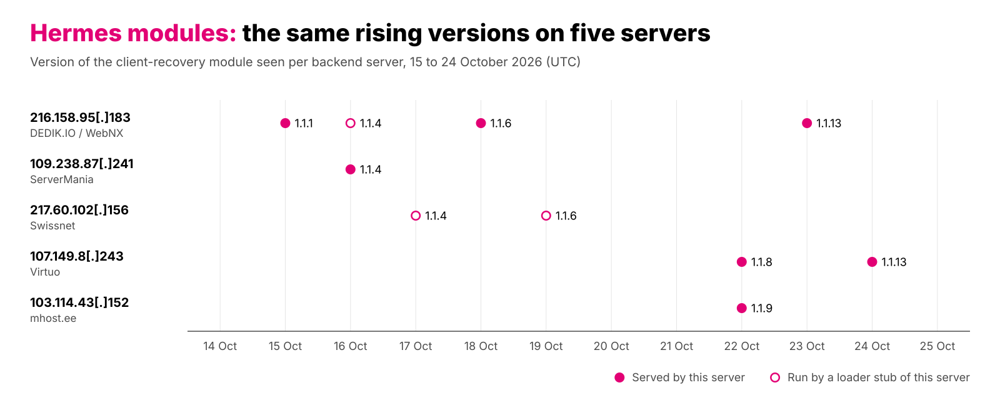
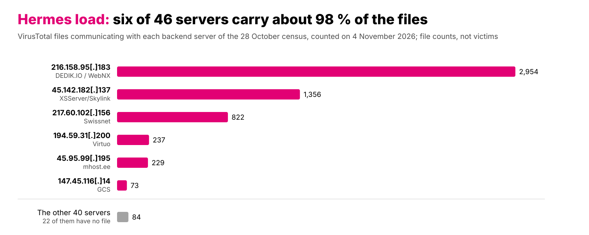
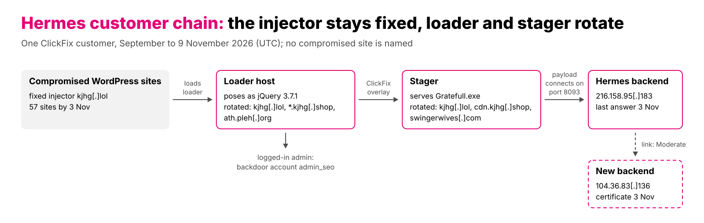

The Hermes stealer went on sale on 21 August. The first backend servers appeared in the first week of September, and within the following three weeks, half of the servers in our later census had been set up. Public lists took longer to catch up: ThreatFox first named a Hermes server on 17 October, when most of the fleet was already in place. Even then, public lists mainly covered servers already linked to samples, while most servers found only through scanning had no files of their own on VirusTotal. This report counts and dates the fleet from the outside: 46 servers in the census of 28 October, and at least 55 known by 9 November. It also traces one customer's infrastructure from at least 57 compromised WordPress sites, through ClickFix pages, to its backend and eventually to a new server.
<!--more-->

## Key Takeaways

- The fleet was built fast but listed late. Half of the 46 census servers date from three weeks in September. Hermes first appeared on a public list by name six weeks after the first servers.
- One vendor maintains the kit: module versions, loader builds and panel builds match across servers at different hosters. It is likely used by more than one customer.
- Public lists and sample feeds cover only part of the fleet. Of the 46 servers, 21 were not on ThreatFox, and 22 had no VirusTotal file of their own.
- The delivery channels vary, but the kit remains the same. Look for HTTP on ports 8080, 8093 and 8787 with paths such as `/ws/publisher` and `/chunks/<id>/manifest.json`, and for the kit's loader, which carries a section named `.loldcfg`, `.olcfg` or `.mscfg` (see For Defenders).
- One customer shows the whole chain: at least 57 compromised WordPress sites, most with an injected script that shows visitors a ClickFix page and creates a backdoor account, `admin_seo`, when an administrator is logged in.

## Campaign Context

[ZeroFox](https://www.zerofox.com/intelligence/the-underground-economist-volume-6-issue-19/) reported on 11 September that Hermes had been advertised on 21 August, while [AngelaMos](https://papers.lisdex.sh/hermes/paper.pdf) documented the client, modules and protocol on 24 October. Neither source counts or dates the servers. This report does, using the [ThreatFox](https://threatfox.abuse.ch/browse/malware/win.hermes/) list and a scanner fingerprint as starting points.

According to ZeroFox, an untested actor advertised Hermes on the Exploit forum as a stealer with remote control capabilities and a multi-user panel. Prices ranged from 150 USD for two weeks to 500 USD for a month, with CIS countries excluded. We have not seen the paid forum post ourselves.

The paper published on 24 October provides an inside view of the delivery chain, client, modules, protocol and panel. Its [companion report](https://papers.lisdex.sh/hermes/report.pdf) lists 20 server addresses, 18 of which also appear in our census. We add fleet counts, installation dates and server states. Our census also holds three further addresses that the report names but sets aside because other services were observed on them. Sandbox runs of the kit's loader spoke the kit's protocol to exactly these addresses.

The family appears under three public names, so hunting for only one can miss the others. ThreatFox's original family, `win.hermes`, is associated with unrelated ransomware from 2017. A second family, `win.hermes_stealer`, was added on 1 November, and [Malpedia](https://malpedia.caad.fkie.fraunhofer.de/details/win.hermes_stealer) has an entry under the same name. MalwareBazaar classifies the payloads under the signature `DesktopStreamRAT`.

### Threat Actor

Hermes is a product, not a threat actor. The kit we examined is likely the one advertised, as its name, interface languages, features and timing match. The panel's Russian-language option and default notification templates in Russian may suggest a Russian-speaking vendor. However, public research interprets these features and the exclusion of CIS (Commonwealth of Independent States) countries as a market choice rather than evidence of citizenship. We make no claims about the vendor's identity or sales. A comparison of paths and configuration markers against publicly documented kits and open-source projects found no matches.

## Impact

Hermes first steals data stored in the browser and then gives the customer remote control of the victim's computer. Public lab runs show it collecting saved browser passwords and crypto-wallet extensions, while the advertisement also mentions Discord and Steam account tokens. Depending on the subscription tier, the panel offers features such as live screen viewing, a hidden desktop, a keylogger and a command shell for each victim. The hidden desktop allows the customer to operate the victim's computer and access logged-in accounts through a separate desktop that remains invisible to the victim.

The lures observed so far target a broad audience rather than a specific sector: visitors to compromised WordPress sites, users searching for cracked software, game cheats or Windows updates, freight staff opening fake rate confirmations, and developers cloning fake Python repositories. The number of infected users remains unknown, as no public source provides victim counts.

## Measuring Methodology

We counted and dated the fleet in four steps.

1. **Sample to backend.** On 27 October, we obtained the payload `Gratefull.exe` from the ClickFix customer's stager. In a [VirusTotal](https://www.virustotal.com/) sandbox, it downloaded a file from `216.158.95[.]183:8093`. A Hermes backend runs on a Windows server and uses four ports: 8080 for the client's WebSocket connection, 8093 for files, 8787 for reports and 8700 for the panel.

2. **Backend to fingerprint.** Port 8080 responds with Go's default 404 page and a Content-Security-Policy (CSP) header referencing `:8700`. A [Censys](https://search.censys.io/) search for this header returned 25 hosts, all but three of them Hermes servers. Two of the three are unrelated and one could not be verified. Searches based on port combinations alone returned between roughly 50 and more than 700 hosts.

   ```
   // add an operating-system filter for Windows, or two unrelated hosts match
   host.services: (port = 8080 and endpoints.http.headers: (key: "Content-Security-Policy" and value: "8700"))
   ```

3. **Verification.** We checked each candidate using [Shodan InternetDB](https://internetdb.shodan.io/) and Censys host records, looking for Windows, the Go 404 page, at least one additional kit port and a self-signed RDP certificate. A server was considered confirmed if two sources showed evidence of the kit, or if a Censys host record contained the header or panel title. Seven servers rest only on a ThreatFox entry and the matching port pattern.

4. **Dating.** We used the creation time of the self-signed RDP certificate generated during Windows setup as the installation date. Where no usable certificate was available, the first VirusTotal file communicating with the server provided the latest possible date. Since the certificate dates the Windows machine rather than the kit itself, it marks the earliest possible date the kit could have been running there. Certificates predating the advertisement were not used for dating.

We measured activity by counting VirusTotal files communicating with each server and identified delivery channels from lure names. To investigate links between servers, we compared shared certificates, SSH host keys, samples and certificate creation times.

### Limits

All information came from passive data collection, and we made no direct requests to any server under investigation. The only exceptions were two samples downloaded from attacker infrastructure, one of which was run in sandboxes, and one publicly accessible panel login page opened in a browser without signing in. The census conducted on 28 October represents the last complete view of the fleet. Data collected afterward covers individual servers only.

## The Fleet in Numbers

The census captures only servers visible through our methodology, so all reported counts are minimum estimates. Unless stated otherwise, counts refer to the 46 servers of that census, and VirusTotal file counts are as of 4 November. For example, the fingerprint misses servers without a CSP header, including six that were running at the time of the census.

| The fleet in numbers | Count |
|---|---|
| Servers at the census of 28 October | 46, at 21 low-cost hosting providers (Appendix B) |
| – with a date (machine certificate or first file) | 38 |
| – dated to the three weeks from 7 to 27 September | 23 |
| – dated before 17 October, when ThreatFox first named Hermes | at least 36 (20 later on ThreatFox, 16 found only by scanning) |
| – named on the ThreatFox list / found only by scanning | 25 / 21 |
| – still serving the kit on 28 October / ended / unverified | 28 / 15 / 3 |
| – without a VirusTotal file of their own, 4 November | 22 |
| Found after the census, to 9 November | 9 confirmed, so at least 55, and 2 more rated likely |

The additions show what a single source misses. A second scanner, run with the same fingerprint a week after the census, returned servers the first had not shown, some of them scanned before the census.

### Growth and Listing

Of the 46 servers, 38 have a date. For 25 it comes from the machine's certificate and for 13 from the first file. Three certificates date from 2 to 6 September, and a sandbox saw the first Hermes traffic on 7 September. Then the fleet grew fast: 23 of the 38 dated servers fall in the three weeks from 7 to 27 September. After that, two to four servers followed each week.

A certificate date is the earliest day Hermes could have run there, and a first-file date is the latest (see Dating in the methodology). Where a server has both, the file came 1 to 50 days after the certificate. Servers that went offline before any scan are missing from the curve.


*Figure 1: Servers of the 28 October census by install date, cumulative (line, 38 of 46 dated), and new VirusTotal files per week (bars), 17 August to 8 November 2026. ThreatFox first named Hermes on 17 October. The last week is partial.*

File volume increased later, from fewer than 50 new VirusTotal files per week in early September to around 2,660 in the week of 26 October, after the ThreatFox listing and the paper's publication. Part of this peak may reflect increased attention, because public listings attract researcher submissions and payloads rebuilt for each download produce a new hash every time.

ThreatFox first identified Hermes by name on 17 October, about six weeks after the first servers appeared. Two servers had appeared there earlier, on 25 September and 8 October, but were classified as unknown malware, one of them tagged ClickFix, Lold and MaaS. The kit had been seen, but not yet recognised as Hermes. Among the servers dated before 17 October, those later listed by ThreatFox had, with two exceptions, already appeared in samples or scans by then. Of the 16 found only through our later scans, 12 had left no trace. Sample feeds had seen the first group for weeks and mostly missed the second.

### Ended Servers and the List

By 28 October, 15 of the 46 servers were no longer serving the kit: they were offline, had been reinstalled or had their Hermes ports closed. All 15 were on the ThreatFox list, while all 21 servers discovered only through scanning were still active, as expected because scanner searches return running hosts.

| Found through | Servers | Hermes on 28 Oct | Ended | Unverified |
|---|---|---|---|---|
| ThreatFox list | 25 | 7 | 15 | 3 |
| Scanner only | 21 | 21 | 0 | 0 |
| Total | 46 | 28 | 15 | 3 |

The ended third therefore reflects the public list, and servers that disappeared before any scan are missing entirely. Server lifetimes could not be measured, because both dates are known for only three servers. Most dated servers still running at the census were older than four weeks. Whether public listings contributed to the shutdowns remains unknown.

## One Vendor, Many Servers

Servers across 21 hosting providers could run the same product or different look-alikes. Four indicators point to a single product maintained by one vendor: the kit's loader, module versions, installer and panel.

The kit’s loader, LOLD, is a small downloader that the panel’s builder produces for each server from a ready-made template. The vendor has recompiled that template several times, and each build carries its compile date. The earliest LOLD loader we found was compiled on 3 September (Files table, Appendix B). Seven large builds followed between 8 September and 23 October, each appearing on VirusTotal within days (build table under For Defenders). Identical builds appear across servers at different hosters, indicating they originate from the same vendor.

### Module Updates

Module versions indicate that servers receive updates from a common source. On the ClickFix customer's backend, the `client-recovery` module advanced from version 1.1.1 on 15 October to 1.1.13 on 23 October. Between 15 and 24 October, four other servers showed versions from the same sequence. The module collects credentials: according to [the paper](https://papers.lisdex.sh/hermes/paper.pdf), version 1.1.5 added browser extensions for wallets and password managers to its targets. The panel includes an auto-update setting that checks a vendor source, and the paper found seven of eight module catalogues to be byte-identical across servers.


*Figure 2: Version of the client-recovery module on five backend servers, 15 to 24 October 2026. Filled dots are versions a server delivered, hollow dots versions run by one of its LOLD loaders.*

The installer changed as well: servers set up from early October send a longer CSP header than earlier ones, which Appendix B uses to bracket the install date of servers without a usable certificate.

### One Panel Build

At least four panels served identical pages, indicating a shared build but not necessarily a shared customer. On one panel, the files were redeployed on 28 October with a new main bundle but an unchanged core, suggesting the panel is rebuilt centrally.

We opened one public login page without signing in, saved the browser's page-load record (HAR file) and examined the front-end code for menu entries, permissions and routes. Beyond tools for individual victims, the code describes features for teams: worker accounts with a permission matrix, shareable guest views, Telegram alerts for new victims and logs, and pages for building and hosting payloads. It also defines three tiers, Titanium, Platinum and Diamond, matching the seller's price card reproduced in the paper. The front-end code shows which features the panel offers, but does not confirm that all of them work.

### Relay Certificates

On 26 October, six servers received the same change within twelve minutes. Between 17:05 and 17:17 UTC, each created a self-signed certificate named Hermes Reverse Relay on port 8453. The six stand at six different hosters and were installed up to seven weeks apart. By 30 October, six more servers had the certificate. These are the certificates' own dates, and four of the twelve servers were found only after the census.

The relay is a feature of the panel. Who switched it on is not known. A vendor update and one customer with six servers would look the same from outside, and none of our other tests links the six.

So the servers run one centrally maintained product whose modules, installer and panel follow the vendor's schedule, assessed with High confidence.

## Who Runs the Servers

Who runs the servers is harder to say than who maintains them. File counts, delivery channels and links between servers show what can and cannot be said.

### Six Servers Carry Most of the Files

File counts show where the visible activity is. Of about 5,800 files that VirusTotal ties to the fleet, about 98 % talk to six servers, and the ClickFix customer's backend alone accounts for half. At the other end, 22 servers have no file of their own, most of them among the 21 found only by scanning.


*Figure 3: VirusTotal files of the six busiest servers and of the other 40 in the census, counted on 4 November 2026. File counts are not victim counts.*

A server without files is not necessarily inactive, as its payloads may never have reached a sandbox. File counts also do not confirm ongoing activity: they include automated mass submissions, and one server continued receiving files after its Hermes ports had closed. Three of the six busiest servers had stopped serving the kit by the census and are listed with the other ended servers in Appendix B.

### Distribution Channels

File names on the six busiest servers provide clues about their delivery channels. The busiest is the ClickFix customer's backend, which is probably shared with other distributors (see The Payload). One server is linked to a fake Windows update and another to a cracked `FL Studio pro.exe`, while the remaining three show only random file names. Freight-document lures appear on smaller servers, and AngelaMos documents a chain involving fake Python repositories, PyMapper, whose server is in the same network as its backend.

One delivery channel can be traced back to before its use of Hermes. Until mid-October, the `FL Studio pro.exe` lure communicated with two other servers. VirusTotal identifies one of those samples as Vidar, while another shows Vidar's Telegram dead-drop pattern. From 16 October onward, the same lure communicated with the Hermes server `217.60.102[.]156` in the same SWISSNET address block. This suggests that one cracked-software distributor switched from Vidar to Hermes without changing its lure.

### How Many Customers

The kit is likely used by more than one customer, probably at least three, assessed with Moderate confidence. A delivery channel does not necessarily represent a separate customer, as the ClickFix customer alone uses several lures. However, three chains have their own history and infrastructure: the ClickFix customer, the cracked-software distributor and the PyMapper chain.

The rest of the fleet cannot be split among customers. According to [the paper](https://papers.lisdex.sh/hermes/paper.pdf), the advertisement offers a “self-hosted botnet”, and varying install dates fit that. This proves little, because the builder puts one server address into each payload whoever runs the servers. Servers are linked in only four places. Two links are strong: two servers at different hosting providers share an RDP certificate and SSH host key, and one sample uses two neighbouring servers. Two are weaker: one server's header names a neighbour as its panel, and three certificates were created within four minutes (see the notes in Appendix B). One customer with many servers looks like many customers with one each, so the number lies between a handful and about forty.

## Case Study: A ClickFix Customer

The ClickFix customer is the one customer whose chain can be followed from the compromised site to the backend.


*Figure 4: The ClickFix customer's chain, September to 9 November 2026: a fixed injector on compromised WordPress sites, rotating hosts for the loader script and the stager, the Hermes backend and its probable successor.*

### Injector, Loader Script and Host Rotation

By 3 November, when we stopped counting, we had found at least 57 WordPress sites compromised by this customer. On 45 of them the page carries the injector `kjhg[.]lol`, and the others carry an older fake plugin or loader script, or only redirect visitors. The injector remains unchanged and loads a second script, the loader script, from the currently active loader host. The loader script disguises itself as "jQuery 3.7.1", the version shipped with WordPress. Its hosting moved from `kjhg[.]lol` through three `kjhg[.]shop` subdomains to `ath.pleh[.]org` on 22 October, when the registrar parked `kjhg[.]shop`. The stager serving the payload moved to `swingerwives[.]com` on 16 October. This re-registered expired domain uses the same name servers as the others, indicating it is controlled by the customer rather than being a compromised site.

### A Dual-Purpose Loader Script

The loader script serves two purposes depending on the visitor. After a bot check, Windows visitors are shown a ClickFix overlay imitating a Cloudflare browser check. When a logged-in administrator visits, the loader script instead creates an account named `admin_seo` through WordPress's own user creation process and reports the credentials back as a "lead". This allows the same script to deliver payloads to visitors while establishing persistent access to the site through its administrators.

### How the Sites Were Compromised

How the injector reached the sites can only be inferred from its placement. The sites run WordPress versions ranging from 4.2 to 7.1 and share neither a hosting provider nor an agency. On 26 sites, the injector appears in the database in a form matching one of six plugins with known unauthenticated stored-XSS vulnerabilities: Popup Builder, Eventin, tagDiv Composer, Slider Hero, Beautiful Cookie Consent and Themify Builder. Appendix C provides the affected versions, CVEs and advisories.

Plugin versions were visible only on the Popup Builder and Eventin sites, and all of them were in the affected range. Older sites also contained the customer's own fake plugin, `clear-index`, while some hosted backdoors from other actors. The customer therefore appears to exploit a range of known stored-XSS vulnerabilities, with the loader script turning temporary access into persistent administrator accounts.

### The Payload

The customer has been using Hermes since early October. Its payload, `Gratefull.exe`, is a crypter rebuilt for each download, producing new hashes, section names and timestamps around an almost identical core. This helps explain why sandboxes observed little activity. Behind the crypter is the kit's LOLD loader, which retrieves files from the backend `216.158.95[.]183`. The crypter is therefore likely the customer's choice, while the loader behind it belongs to the kit. The crypter's encoded content has not been decoded. The backend is also likely shared with other customers: its traffic predates this customer's first observed use, and most files associated with it have names not seen in this chain.

### After the Listing: a New Server

ThreatFox listed the domains of the injector and the loader script on 19 October, followed by the stager two days later. The campaign continued, with new sites carrying the injector appearing for another two weeks. The loader script's host changed three days after the listing, but its replacement had been prepared a month earlier, making it unclear whether the change was a reaction or routine rotation.

The backend changed in November. On 3 November, `216.158.95[.]183` was still responding as a Hermes file server in a public urlscan scan, but three days later it showed no services. A builder payload first seen on 5 November contacted a new server, `104.36.83[.]136`, whose certificate was issued on 3 November. Sandbox runs on 7 November confirmed that it served Hermes files. The same payload also contacted `2.27.248[.]10`, a host that payloads of the old backend had contacted before. This suggests that the customer, or another operator sharing that host, acquired a new server, assessed with Moderate confidence because the link relies on a single file and shared host. Whether the new server replaced the old backend remains unconfirmed.

## Recommendation

Hermes runs the same kit on every server we could check, while the servers last for weeks and are then reinstalled or reused. So detection built on the kit's protocol and files is likely to outlast address lists. Delivery in front of the kit differs per customer and needs its own detection.

### For Defenders

#### On the Network

A Hermes client reaches its server on four ports with fixed paths. Every path below comes from our own data, sandbox runs and public scans of the servers:

```
8080  /ws/publisher?deviceId=<id>&deviceName=<host>     WebSocket, <id> is 64 hex characters or olympic-<32 hex>
8093  /chunks/p_<16-18 hex>/[v3/]manifest.json, /chunks/<id>/[v3/]<n>.bin
8093  /files/bld_<24 characters>.exe, /files?prefix=inbox/<id>/
8093  /files/hb/<16 hex>.json                            heartbeat
8787  /api/client/report, /api/client/screenshots
8700  /api/modules/catalog, /api/modules/pins, /api/modules/<name>/<version>
      The panel's API answers on 8700 carry the response header X-Hermes-Server-Time. So did JSON error answers on /chunks/.
```

This is plain HTTP on unusual ports, usually straight to an IP address, so look in firewall logs and in sensors that parse HTTP on any port. Among the 3,846 URLs we collected in this case, patterns for the manifest, publisher, `bld_` and heartbeat paths matched only Hermes servers. Ordinary traffic is untested.

#### In Files

The LOLD loader contains a small configuration section named `.loldcfg`, `.olcfg` or `.mscfg`. These names appear in 5,375 of the 5,793 files linked to the fleet. The first rule below matches these known names. The second covers other short section names ending in `cfg`, as the vendor has renamed the section twice while retaining that suffix. The third looks for strings found in the loader's code. The first and third rules matched a real loader from the 18 September build, while none of the rules matched any of 17,666 clean Windows files. We had no file from a later build to test, the second rule has only been tested against test files, and other malware has not been evaluated. A customer-side crypter such as `Gratefull.exe` bypasses all three rules, as would a build that removes the `cfg` suffix and changes the strings.

```
import "pe"

private rule hermes_lold_pe_frame
{
    // 64-bit EXE of the loader's size with .pdata as fourth section
    condition:
        uint16(0) == 0x5A4D and
        filesize > 300KB and filesize < 12MB and
        pe.machine == pe.MACHINE_AMD64 and
        (pe.characteristics & pe.DLL) == 0 and
        pe.number_of_sections >= 7 and pe.number_of_sections <= 12 and
        pe.sections[0].name == ".text" and
        pe.sections[3].name == ".pdata"
}

rule hermes_lold_loader_cfg_named
{
    // known config section name in its known place
    condition:
        hermes_lold_pe_frame and
        for any i in (4 .. 5) : (
            (pe.sections[i].name == ".loldcfg" or
             pe.sections[i].name == ".olcfg" or
             pe.sections[i].name == ".mscfg") and
            pe.sections[i].raw_data_size >= 512 and pe.sections[i].raw_data_size <= 8192 and
            (pe.sections[i].characteristics & pe.SECTION_MEM_EXECUTE) == 0 and
            (pe.sections[i].characteristics & pe.SECTION_CNT_CODE) == 0
        )
}

rule hermes_lold_loader_cfg_renamed
{
    // the same section under another short name ending in cfg, with the loader's exact sizes
    condition:
        hermes_lold_pe_frame and
        not hermes_lold_loader_cfg_named and
        pe.number_of_exports == 0 and
        pe.imports("bcrypt.dll") and pe.imports("advapi32.dll") and pe.imports("shell32.dll") and
        for any i in (4 .. 5) : (
            pe.sections[i].name matches /^\.[a-z0-9_]{0,4}cfg$/ and
            pe.sections[i].name != ".00cfg" and
            (pe.sections[i].raw_data_size == 512 or pe.sections[i].raw_data_size == 4608) and
            pe.sections[i].virtual_size <= 8192 and
            (pe.sections[i].characteristics & pe.SECTION_MEM_EXECUTE) == 0 and
            (pe.sections[i].characteristics & pe.SECTION_CNT_CODE) == 0
        )
}

rule hermes_lold_loader_strings
{
    // strings from the loader's code and manifest, read from the build of 18 September
    strings:
        $marker    = "LOLD_CFG_V1" ascii
        $manifest  = "Lold.UpdateClient" ascii
        $mutex     = "Local\\Lold_" wide
        $ua        = "Lold/1.0" wide
        $arg       = "--lold-container" wide
        $keepalive = "PayloadKeepAlive exit:" wide
    condition:
        uint16(0) == 0x5A4D and
        filesize < 12MB and
        pe.machine == pe.MACHINE_AMD64 and
        3 of them
}
```

Within a build the imphash stays the same while every download has a new file hash, so search by imphash too, in EDR telemetry, Sysmon logs or MalwareBazaar. The table lists the seven large builds, which cover 5,371 of the 5,375 files, and the newest build we saw, from 1 November. A file wrapped in a customer's crypter shows the crypter's imphash instead.

| imphash | PE timestamp (UTC) | Section | Files |
|---|---|---|---|
| `2158fc93786ba2da88911114ba89e4b4` | 8 Sep 00:14 | `.loldcfg` | 1,407 |
| `7be476d096ff2d43b2380de66c82171e` | 18 Sep 21:27 | `.loldcfg` | 353 |
| `71eb0f18e577947f062d0811f3a37327` | 4 Oct 21:32 | `.loldcfg` | 1,448 |
| `3753837b557ce77f6316300eb2cabf42` | 14 Oct 15:16 | `.loldcfg` | 1,843 |
| `7a73da9787a94ef52d35df41c7c2031f` | 16 Oct 00:09 | `.olcfg` | 135 |
| `ad699e731a46c6d968bd4bedf751608a` | 18 Oct 18:44 | `.mscfg` | 134 |
| `c1416dd4b9b167f5a8490aa63ade36dc` | 23 Oct 09:57 | `.mscfg` | 51 |
| `1637b8e12bf18a63470a7889fb2c8f9b` | 1 Nov 21:49 | `.olcfg` (4,608 B) | 1 |

#### Server Addresses

Appendix B lists the servers. Use the ended ones only to search logs from September and October, because those addresses have been reinstalled or passed on. Check a live address again before relying on it: one ended address showed a different login panel ten days later.

#### Compromised WordPress Sites

Whoever cleans up a site hit by this customer should update the six plugins named in the case study to the versions in Appendix C. A current WordPress core did not protect, since ten of the sites ran a 7.1 core. Then search the database and the site's PHP files for the injector domain `kjhg[.]lol`, check those plugins' settings for stored script, and look for the plugin folder `clear-index` and unknown administrators such as `admin_seo`. A script that calls itself "jQuery v3.7.1" but loads from another host is suspect.

#### Finding More Servers

These selectors helped identify the fleet and can be reproduced in any internet scanner:

- To find servers, search for responses on port 8080 containing a `Content-Security-Policy` header referencing `:8700`, and filter for Windows hosts. Without this filter, two unrelated hosts matched. Verify each result as described in step 3 of the methodology.
- The relay certificate provides a second indicator: a self-signed certificate on port 8453 with the subject name `Hermes Reverse Relay`. So far, it has only appeared on servers also identified by the header search.
- Identify panels using the hashes of their front-end files (Appendix B). Pages titled "Hermes Panel" without these files turned out to be unrelated.
- If no scanner has a recent record of a server, check public urlscan submissions for requests to port 8093 containing `/chunks/` or `/files/` in the URL. These provided timestamped responses.
- Certificates created within the same minute may result from a vendor update, as seen with the relay certificates. They only indicate shared ownership when supported by additional evidence.

## Conclusion

The first weeks of Hermes went quickly. The kit went on sale on 21 August, the first servers stood about two weeks later, and half of the 46 servers we counted followed within three more weeks. The vendor kept pace with seven large loader builds in under seven weeks and module updates within days. At least one distributor probably brought an existing channel along: a cracked-software lure that delivered Vidar until mid-October. The Hermes name reached a public list six weeks after the first servers, when most of the fleet already stood.

For defenders this has a practical consequence. Addresses and payload hashes changed within weeks, while the ports, protocol paths and loader were the same on every server we could check. Detection built on those is likely to outlast address lists (see For Defenders).

This probably holds for the next kit as well. In its first weeks a new kit is ahead of the lists, and almost half of the 46 servers had no VirusTotal file of their own. Counting or blocking such a fleet early takes a scanner fingerprint next to the feeds, and the servers’ own certificates to date it. [The paper](https://papers.lisdex.sh/hermes/paper.pdf) gives the inside view of client, modules and protocol. This report adds the outside view: how many servers, since when, and how to find them.

This report was produced with AI assistance.

---

## Appendix A: MITRE ATT&CK Mapping

The mapping follows [ATT&CK v20](https://attack.mitre.org/). Rows that say "per the paper" rest on the AngelaMos paper.

| Tactic (MITRE) | Technique | ID | Campaign Mapping | Behavioral Indicator |
|---|---|---|---|---|
| Resource Development | Develop Capabilities: Malware | T1587.001 | Kit with panel, modules, auto-update from vendor source, shared module versions | Same `client-recovery` version on servers with no known link |
| Resource Development | Obtain Capabilities: Malware | T1588.001 | Customers buy the kit, tiers Titanium, Platinum and Diamond in the panel code | - |
| Resource Development | Acquire Infrastructure: Virtual Private Server | T1583.003 | 46 Windows servers at 21 low-cost hosting providers, set up from the first week of September | 8080 Go 404 with CSP naming `:8700`, 8093, 8787 |
| Resource Development | Acquire Infrastructure: Domains | T1583.001 | ClickFix customer: `kjhg[.]lol`, `kjhg[.]shop`, `pleh[.]org`, re-registered `swingerwives[.]com` | Shared Cloudflare NS pair fay/louis |
| Resource Development | Compromise Infrastructure: Server | T1584.004 | At least 57 compromised WordPress sites (by 3 November), 45 of them serving the injector | - |
| Resource Development | Stage Capabilities: Drive-by Target | T1608.004 | Injector loads the loader script disguised as jQuery 3.7.1 | "jQuery v3.7.1" header served from a non-CDN host |
| Initial Access | Exploit Public-Facing Application | T1190 | Stored XSS in six plugin groups, inferred from where the injector sits, matching unauthenticated CVEs | Script in plugin settings (Popup Builder, Eventin, tagDiv, Slider Hero, Cookie Consent, Themify) |
| Initial Access | Drive-by Compromise | T1189 | Compromised page loads the loader script, which loads the overlay | - |
| Execution | User Execution: Malicious Copy and Paste | T1204.004 | ClickFix overlay for Windows visitors, command text withheld | - |
| Execution | User Execution: Malicious File | T1204.002 | Lure names of other customers: `FL Studio pro.exe`, `windows_update_assistant.exe`, `Rate Confirmation.bat` | Execution parents `Pro.zip`, `Pro1.zip`, `Pro2.rar` |
| Persistence | Create Account: Local Account | T1136.001 | Loader script creates admin account `admin_seo` when a logged-in admin visits, local WordPress service account, not a cloud account | Unknown WordPress administrator `admin_seo` |
| Persistence | Boot or Logon Initialization Scripts: Logon Script (Windows) | T1037.001 | Per the paper only: `UserInitMprLogonScript` points to `wcprov.exe`, single source | `HKCU\Environment\UserInitMprLogonScript` set |
| Stealth | Obfuscated Files or Information: Software Packing | T1027.002 | `Gratefull.exe` crypter stub, blob, section names, version info re-rolled per build | `.didat` > 1 MB, entropy ~6, `.rodata` of a single byte value |
| Stealth | Masquerading | T1036 | Fake version info "Quilltree Solutions Ltd", "Kobalt Digital OU" | Unsigned EXE, FileDescription ending in `- file tools` |
| Stealth | Virtualization/Sandbox Evasion: System Checks | T1497.001 | Anti-VM strings, machine GUID check, no network in two own sandboxes | Mutex `Local\Lold_<16 hex>` per the paper (a LOLD mutex in our sandbox), exit without network |
| Discovery | System Location Discovery: System Language Discovery | T1614.001 | UI/supported-language check before running, CIS excluded per ZeroFox and the paper | Early exit on excluded UI language |
| Discovery | System Location Discovery | T1614 | IP-based country lookup to gate execution, per the paper | Geolocation lookups to `ipwho[.]is`, `ip-api[.]com` |
| Command and Control | Ingress Tool Transfer | T1105 | Chunk download from `216.158.95[.]183:8093` | `/chunks/<id>/manifest.json` on 8093 |
| Command and Control | Non-Standard Port | T1571 | 8080 publisher, 8093 files, 8787 reporting, per the paper | HTTP/WebSocket to 8080/8093/8787 on Windows hosts |
| Command and Control | Application Layer Protocol: Web Protocols | T1071.001 | `/ws/publisher?deviceId=`, `/api/client/report`, per the paper | User agents `DesktopStreamClient/0.1`, `Lold/1.0` per the paper |
| Command and Control | Proxy: External Proxy | T1090.002 | Edge and relay nodes front the origin stream server. Edge profile on `192.109.139[.]94` per the paper | Panel-less, CSP-less fleet servers answering `/health` with `stream.mode edge` |

The kit also offers functions that we read from the panel code or the paper but did not see in use: screen viewing (T1113), keylogging (T1056.001), clipboard capture (T1115), automated collection of browser passwords and wallets (T1119, T1555.003), a command and PowerShell shell (T1059.001, T1059.003), a hidden desktop (T1219) and exfiltration of reports and screenshots over the C2 channel (T1041).

## Appendix B: Indicators of Compromise

The server tables show the state at the census of 28 October. "Installed" is the date of the server's self-signed RDP certificate. A row without a certificate names the first sample instead. "ThreatFox only" marks a server known from one ThreatFox report plus its port pattern. The hosters are shared, so validate an address before blocking it.

### Hosting Providers (Census of 28 October)

The servers stand at 21 low-cost hosting providers, none with more than six.

| Hosting provider | Servers | Hermes on 28 Oct | Ended | Unverified |
|---|---|---|---|---|
| MillenialHost | 6 | 5 | 1 | 0 |
| DEDIK.IO / WebNX | 6 | 5 | 0 | 1 |
| mhost.ee | 5 | 2 | 3 | 0 |
| ServerMania | 4 | 2 | 1 | 1 |
| Virtuo | 4 | 3 | 1 | 0 |
| OVH, Stellar, VPSPay, ColoCrossing | 2 each | 1 each | 1 each | 0 |
| MGN / Omegatech | 2 | 0 | 2 | 0 |
| Eleven providers, one server each | 11 | 7 | 3 | 1 |
| Total, 21 providers | 46 | 28 | 15 | 3 |

Two address blocks stand out, one with six servers at MillenialHost and one with four at ServerMania.

### Network: Hermes Backend Servers (Live or Unverified on 28 October)

The table lists the 31 census servers that had not ended: 28 still serving the kit on 28 October and 3 unverified, the last three rows. Eleven servers confirmed or rated likely after the census follow in a separate table (nine confirmed, two likely), because their state on 28 October is unknown. A third table holds the 15 servers that had ended by the census.

| Address | Hoster | Installed | Note |
| --- | --- | --- | --- |
| `216.158.95[.]183` | WebNX / DEDIK.IO | 6 September | One of the six busiest servers. C2 of `Gratefull.exe`, no services on 6 November |
| `109.238.87[.]239` | ServerMania | 6 September | Panel 8700, CSP names `109.238.87[.]241:8700`. Relay certificate issued 26 October. Second address `152.232.133[.]14` with the same RDP certificate and SSH key |
| `5.252.155[.]31` | mhost.ee | 9 September | - |
| `192.109.139[.]105` | MillenialHost | 13 September | - |
| `192.109.139[.]125` | MillenialHost | 14 September, 21:42 | No CSP, no panel. One sample fetches its files from `192.109.139[.]89` |
| `192.109.139[.]113` | MillenialHost | 14 September, 21:44 | Installed within four minutes of `.125` and `.110` |
| `192.109.139[.]110` | MillenialHost | 14 September, 21:46 | No CSP |
| `204.13.238[.]50` | Interserver | 14 September | Relay certificate issued 27 October |
| `85.239.149[.]84` | DEDIK.IO | 18 September | RDP on 1337, relay certificate issued 26 October |
| `188.190.9[.]126` | EDIS | 21 September | - |
| `109.238.86[.]130` | UFO-Technologies | 22 September | Panel 8700, RDP certificate and SSH key shared with `51.255.78[.]10` |
| `51.255.78[.]10` | OVH | 22 September | CSP names the panel of `109.238.86[.]130` |
| `107.149.8[.]243` | Virtuo AS399486 | 23 September | `client-recovery` 1.1.8 and 1.1.13 |
| `194.59.31[.]200` | Virtuo AS399486 | 24 September | One of the six busiest servers, fake update lure. On ThreatFox since 8 October as an unknown stealer |
| `192.109.139[.]94` | MillenialHost | 26 September | ThreatFox only |
| `93.152.220[.]82` | DEDIK.IO | 27 September | RDP on 1337 |
| `31.57.38[.]30` | Virtuo (Canada) | 28 September | August ScreenConnect hostname on this IP is not Hermes |
| `144.31.53[.]142` | vpspay.net | 3 October | Freight lure, file server still answering on 3 November |
| `95.85.244[.]3` | NFS-AS | 5 October | - |
| `45.141.21[.]176` | Stellar Group SAS | 6 October | Panel 8700, source of the panel file hashes below. Only RDP and 8080 on 1 November |
| `212.43.148[.]128` | Podaon | 16 October | Relay certificate issued 26 October |
| `217.60.102[.]156` | SWISSNET AS209373 | No certificate, first sample 16 October | One of the six busiest servers. The crack lure earlier talked to `217.60.103[.]161` and `217.60.103[.]223`, probably Vidar |
| `65.108.207[.]11` | Hetzner | 22 October | Relay certificate issued 26 October |
| `192.227.183[.]22` | ColoCrossing | 22 October | RDP on 1337 |
| `96.62.218[.]164` | DEDIK.IO | Unknown (certificate 9 July) | Certificate predates the ad |
| `216.158.94[.]35` | WebNX | Before about 1 October (short CSP, certificate 12 June) | RDP on 1337, relay certificate issued 28 October |
| `93.190.247[.]218` | mhost.ee | Before about 1 October (short CSP, template certificate 20 August) | Relay certificate issued 26 October |
| `109.238.87[.]120` | ServerMania | After about 1 October (long CSP) | Panel 8700, relay certificate issued 30 October |
| `109.238.87[.]128` | ServerMania | Unknown | ThreatFox only. Answered on 8787 19–20 October, not verified on 28 October |
| `2.27.4[.]70` | Kyonix AS210457 | Unknown | ThreatFox only. Live 19–20 October, not verified on 28 October |
| `96.62.218[.]147` | DEDIK.IO | Unknown | Live 23–24 October, not verified on 28 October |

Certificates older than the advertisement of 21 August give no install date. Where a row says before or after about 1 October, the date comes from the CSP header: among the 14 certificate-dated servers seen by the second scanner, those installed until late September send a short header and those installed from early October a longer one, without exception.

### Network: Servers Added After the Census (to 9 November)

"First record" is the earliest file or scan that shows the kit on the address. For some servers it predates the census, because we found them only later.

| Address | Hoster | First record | Note |
| --- | --- | --- | --- |
| `104.239.66[.]157` | Stellar Group SAS | 29 October | Installed after about 1 October, relay certificate issued 26 October |
| `45.115.26[.]147` | SolidCore / Ivacy Limited | 25 October | Installed after about 1 October, 8700 in InternetDB |
| `185.215.151[.]115` | MillenialHost | 10 October | Rated likely. Installed before about 1 October, current state unknown |
| `193.148.56[.]154` | Neterra / WULDI | 11 October | Rated likely. Installed before about 1 October, current state unknown (RDP only on 6 November) |
| `193.148.56[.]77` | Neterra / WULDI | 31 October | No CSP header on 8080, so invisible to the fingerprint |
| `104.36.83[.]136` | Redoubt Networks | 5 November | RDP certificate issued 3 November. Payload shares a host with the ClickFix customer's payload |
| `185.215.151[.]179` | MillenialHost | 5 November | Relay certificate issued 28 October |
| `191.217.210[.]232` | Kyonix | 5 November | Relay certificate issued 30 October |
| `212.43.157[.]17` | Podaon | 6 November | Relay certificate issued 28 October |
| `173.214.167[.]231` | Interserver | 3 November | Port 8453 open with a `localhost` certificate |
| `199.104.63[.]107` | Stellar Group (AS58291 ColoCenter) | 4 November | Port 8453 open with a `localhost` certificate. Samples request the module API on 8700 |

### Network: Servers Ended by 28 October (Old Logs Only)

These 15 servers no longer served the kit on 28 October: they were offline, reinstalled or had the kit's ports closed. All 15 are on the ThreatFox list. Use them to match logs from September and October, not to block. "First seen" is the first VirusTotal sample tied to the kit that talked to the server, unless a certificate is named.

| Address | Hoster | First seen | Note |
| --- | --- | --- | --- |
| `45.142.182[.]137` | XSServer / Skylink | 7 September | Second busiest server, 1,356 VirusTotal files. First Hermes protocol contact, 7 September. Not answering on 28 October |
| `45.95.99[.]195` | mhost.ee | 29 September | Fifth busiest, 229 files. Not answering on 28 October |
| `147.45.116[.]14` | GCS | 12 September | Sixth busiest, 73 files. Reinstalled |
| `103.114.43[.]152` | mhost.ee | Certificate 2 September, kit first seen 22 October | ThreatFox only. Oldest machine certificate, weak as a date for the kit. Kit ports closed on 28 October |
| `109.238.87[.]241` | ServerMania | 29 September | ThreatFox only. Named as panel address in the CSP of `109.238.87[.]239`. No services on 28 October |
| `91.92.243[.]7` | MGN / Omegatech | 8 September | Server of the earliest LOLD loader. No services on 28 October |
| `217.217.97[.]60` | Stellar Group SAS | 23 September | On ThreatFox since 25 September as unknown malware. Reinstalled 25 October |
| `194.102.104[.]223` | AlexHost | 10 October | No services on 28 October |
| `172.245.25[.]133` | ColoCrossing | 13 September | Reinstalled 27 October |
| `192.109.139[.]89` | MillenialHost | 26 September | ThreatFox only. File server for `192.109.139[.]125`. A Linux host on 28 October |
| `163.5.210[.]203` | Virtuo | 5 October | Ran Ubuntu on 28 October |
| `31.76.100[.]248` | vpspay.net | 9 September | Freight lure, reinstalled 25 October |
| `45.131.214[.]148` | mhost.ee | Certificate 10 September | Freight lure `Rate Confirmation.bat`. Only RDP left on 28 October |
| `158.94.211[.]124` | MGN / Omegatech | 24 September | Fake update lure, not answering on 28 October |
| `151.80.21[.]177` | OVH | Unknown (ports seen 19 October) | ThreatFox only. Answered on the kit's ports for about ten hours. A different login panel on 29 October |

### Network: ClickFix Customer and Related Domains

These domains belong to the Case Study chapter.

| Value | Role | Observed | Note |
|---|---|---|---|
| `kjhg[.]lol` | Injector, in September also loader host and stager | From 7 September | On ThreatFox since 19 October, still injecting on 5 November |
| `kjhg[.]shop` (`cdn.`, `atm.`, `ath.`) | Stager on `cdn.` (3–15 October), loader host (5–21 October) | 3–21 October | On ThreatFox since 19 October, parked by registrar 22 October |
| `pleh[.]org` (`ath.`) | Loader host | From 22 October | Re-registered 21 September, not on ThreatFox |
| `swingerwives[.]com` | Stager | From 16 October | Re-registered 16 October, attacker-owned, on ThreatFox since 21 October |

### Detection Patterns

| Type | Value | Role | Note |
|---|---|---|---|
| Header | `Content-Security-Policy` on 8080 naming `:8700` | Backend | 22 of the 25 hits of 28 October are fleet servers, two are unrelated, one is unverified. Vendor can change it |
| Port profile | Windows, 8080 Go 404 (19 bytes), 8093, 8787, optional 8700 | Backend | More durable than the CSP fingerprint, not unique alone |
| TLS certificate | Subject CN `Hermes Reverse Relay`, self-signed, port 8453 | Relay service of the kit | Second marker, seen on twelve servers. Two servers found in November show a `localhost` certificate |
| PE section | `.loldcfg`, from 16 October also `.olcfg`, from 18 October `.mscfg` | LOLD loader of the kit | On 5,375 of 5,793 fleet files across 20 servers, none of 17,666 clean files. One real loader matched, other malware untested |
| PE section | `.rdpcfg` | Larger payloads under builder file names | Six files of 11 to 19 MB on three servers |
| Header | `X-Hermes-Server-Time` | Panel API and file server | In every panel API response, also on 8093 chunk-path errors |
| SHA-256 | `fbb3fcaec7524c63f38116b48a0b396aa3740e99b6420d7af432de7b4151333d` | Panel `settings-bootstrap.js` | Unchanged 18 to 28 October |
| SHA-256 | `9826c0e82c10ab10b461303f6c0aa858d5268e1a24fdc9f50ed19d48409941e3` | Panel `static/js/445.99b95be3.chunk.js` | Unchanged 18 to 28 October |
| SHA-256 | `4b91c0c24b338d0e92f4bab6dd795c4b26f37e05723e5bf1806a3bce333f3148` | Panel `favicon.svg` | Seen 18 October |
| SHA-256 | `173e8cb10db84780c4812a0a28c333290ef5802abf338521f476bb3f479d28ac` | Panel logo PNG inside `favicon.svg` | - |
| Title | `Hermes Panel` | Panel | Pre-filter only, a Russian ad tool uses the same title |

The panel script `main.<8hex>.js` changes with every panel update (`39accbc7` on 18 October, `b25d377a` on 28 October) and is not a stable indicator.

### Files

Crypters differ per customer and are rebuilt for each delivery, so matching these customer-side sample hashes has retrospective value only. The last three rows are files that a claim in the text rests on.

| Sample | SHA-256 | Note |
|---|---|---|
| `Gratefull.exe` | `15221636d8380ccc882d8c832a2ee9fc4cb09eec1b33efd729e88c2b70afef4f` | Crypter stub of the ClickFix customer, C2 `216.158.95[.]183:8093` |
| `Gratefull.exe` | `9b4038f4186277b09f703ddff49e2929bdfc8fc45470225a7553a1b74e752691` | Second build, `.text` 99.8 % identical |
| `UpdateAgent.exe` | `480f7cc4ab505bd3728de399e1239cae3a32243c5ebee824adcd6a5ea73ed916` | Dropped by `Gratefull.exe` in a sandbox |
| `bld_8kcyIeU3dxr4BWRrMHm2Q3GY.exe` | `5051b4b91de8fbebb31884cf3be01fb381ce6e9704fa0272e8a6b1b50b78caf7` | LOLD loader of the 1 November build. Contacts `104.36.83[.]136` and `2.27.248[.]10`, links the ClickFix customer to the new server |
| `xumcr26.exe` | `97c5867f432ad072fee68399da94fbce96aaa7d180b795cba2d0ad107e1ee063` | Reports to `192.109.139[.]125`, files from `192.109.139[.]89`. Links the two servers |
| `2necqf.exe` | `a3891baf903a53e52b41889210ac1e9ea6472c585e3791b3c693397f048b50d4` | Earliest LOLD loader, compiled 3 September. Talks to `91.92.243[.]7` |

## Appendix C: WordPress Plugins Matching the Injector

On 26 of the compromised sites the injector sits in the database in a form that matches one of these six plugins. "Sites" counts those sites, and "Confidence" rates the match between the injector's placement and the plugin. "Not reported" means no public report of mass exploitation, not evidence of none.

| Plugin | Sites | Confidence | Matching CVE | Affected / fixed | Mass-exploited | Advisory |
|---|---|---|---|---|---|---|
| Popup Builder < 4.2.3 | 7 | High | CVE-2023-6000 | < 4.2.3 / 4.2.3 | yes: Balada, over 6,200 sites from 13 December 2023 (Sucuri) | [cve.org](https://www.cve.org/CVERecord?id=CVE-2023-6000), [WPScan](https://wpscan.com/blog/stored-xss-fixed-in-popup-builder-4-2-3/), [Sucuri](https://blog.sucuri.net/2024/01/thousands-of-sites-with-popup-builder-compromised-by-balada-injector.html) |
| Eventin 4.0.x | 7 | Moderate | CVE-2025-14657 (missing authorization, then unauthenticated stored XSS) | ≤ 4.0.51 / 4.0.52 | not reported | [cve.org](https://www.cve.org/CVERecord?id=CVE-2025-14657), [Wordfence](https://www.wordfence.com/threat-intel/vulnerabilities/wordpress-plugins/wp-event-solution/eventin-event-manager-event-booking-calendar-tickets-and-registration-plugin-ai-powered-4051-missing-authorization-to-unauthenticated-stored-cross-site-scripting-via-post-settings) |
| tagDiv Composer | 4 | Moderate | CVE-2023-3169 | < 4.2 / 4.2 | yes: Balada, over 9,000 sites in September 2023 (Sucuri) | [cve.org](https://www.cve.org/CVERecord?id=CVE-2023-3169), [WPScan](https://wpscan.com/vulnerability/e6d8216d-ace4-48ba-afca-74da0dc5abb5), [Sucuri](https://blog.sucuri.net/2023/10/balada-injector-targets-unpatched-tagdiv-plugin-newspaper-theme-wordpress-admins.html) |
| Slider Hero | 4 | Moderate | CVE-2026-76789 | < 9.1.3 / 9.1.3 | not reported | [cve.org](https://www.cve.org/CVERecord?id=CVE-2026-76789), [WPScan](https://wpscan.com/vulnerability/f9f5485c-6231-492c-b214-8da87a2bf4d1/) |
| Beautiful Cookie Consent | 2 | Low | CVE-2023-3388 | ≤ 2.10.1 / 2.10.2 | mass attempts (Wordfence, from 23 May 2023, payload defective) | [cve.org](https://www.cve.org/CVERecord?id=CVE-2023-3388), [Wordfence](https://www.wordfence.com/blog/2023/05/wordfence-firewall-blocks-bizarre-large-scale-xss-campaign/) |
| Themify Builder | 2 | Low | CVE-2026-95864 | ≤ 7.8.1 / 7.8.2 | not reported | [cve.org](https://www.cve.org/CVERecord?id=CVE-2026-95864), [Patchstack](https://patchstack.com/database/wordpress/plugin/themify-builder/vulnerability/wordpress-themify-builder-plugin-7-8-1-unauthenticated-stored-cross-site-scripting-vulnerability) |
